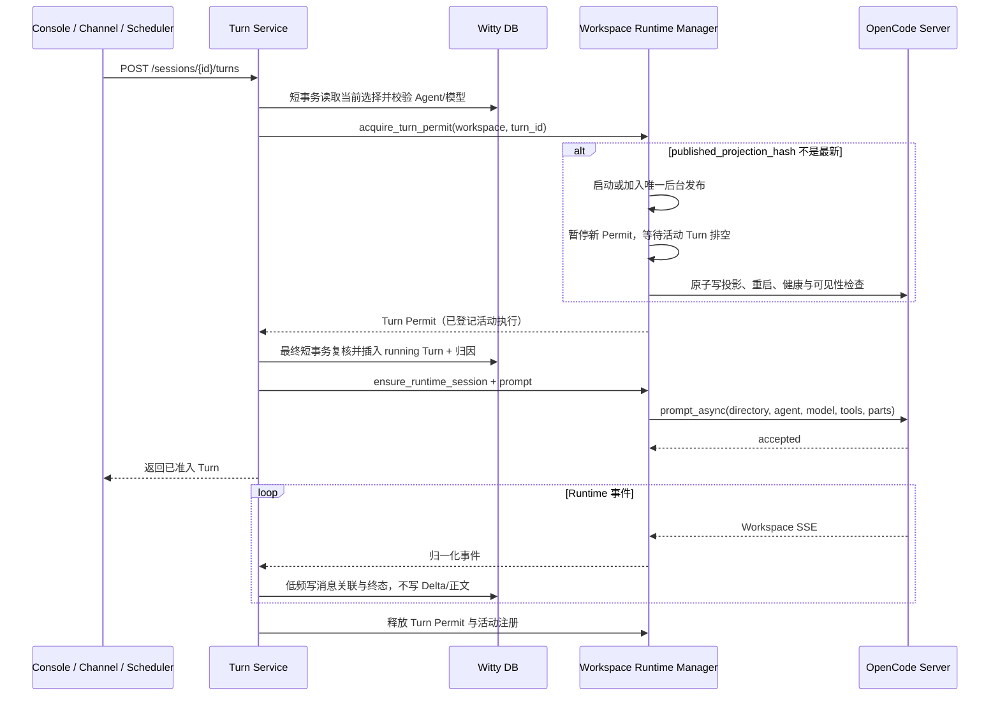

# Agent、Session 与 Workspace：框架与数据流设计方案

> 状态：执行稿（产品决策已统一，实现契约处于 Draft）
> 日期：2026-11-08
> 适用基线：`v2` 分支、单一 OpenCode Runtime、模块化单体、单控制面实例、项目尚未正式投产
> 范围：产品体验、控制面架构、OpenCode 接入、数据模型、核心数据流、清理式迁移与迭代顺序
> 不包含：业务代码实现、微服务拆分、多用户/多租户体系、Team 详细设计、Fork
> 执行分解：[agent-session-workspace-task-plan.md](./agent-session-workspace-task-plan.md)
> 物理模型：[database-model-design.md](./database-model-design.md)

## 1. 结论与已确认决策

需求可行，不需要恢复多 Runtime，也不需要 DB 消息双写。OpenCode 1.17.13 已实测支持同一 Session 逐 Turn 切换 Agent 和模型并保留连续上下文；每轮必须显式传 Agent、model 和 directory，不能依赖隐式继承。

目标形态：

1. 首次使用自动获得默认 Workspace 和 Primary Agent，选模型即可对话。
2. Session 属于 Workspace，不隶属于 Agent；Session 内可切换 Agent 和模型，历史保持连续。
3. 每个活动 Workspace 一个 OpenCode Server，隔离目录、配置、事件和 MCP 连接。
4. OpenCode 是消息唯一事实源；Witty DB 只保存领域元数据、Turn 归因、执行状态和消息归属。
5. Skill 全局共享；MCP 全局安装，按 Session 激活。Agent 不拥有独立 Skill/MCP 权限，Workspace 也不拥有能力绑定。
6. 配置保存不立即停服；下一 Turn 自动确保最新配置已发布。OpenCode 无可靠热更新，发布仍需排空、重启和健康检查。
7. Team 是后续独立协作模式；Fork 不在 P0。

| 决策点 | 结论 |
| --- | --- |
| Session 当前值 | 保存当前 Agent 和当前模型，只作为下一 Turn 的默认输入 |
| Turn 归因 | 固定 `agent_id`、`model_id` 及两者当时展示名；不保存完整执行环境 |
| Agent 编辑 | 原地保存，用 `config_updated_at` 乐观锁；不生成配置版本或 `config_hash` |
| Runtime 投影 | 全部未归档 Agent + enabled 模型/Skill/MCP，确定性物化；只比较单一 `published_projection_hash` |
| 发布触发 | 保存配置不关闭准入；下一 Turn 触发；无显式发布 API、`publish_id` 或持久候选版本 |
| 在飞 Turn | 常规发布永不自动杀死；发布暂停新准入并等待活动 Turn 自然结束 |
| 等待上限 | 触发发布的 HTTP 请求最多等待 10 秒；超时返回 503，内部唯一后台发布继续，不插入 running Turn |
| 发布中再修改 | 当前发布使用开始时冻结的非密输入；完成后仍存在 hash 差异，下一 Turn 再发布，不自动连续重启 |
| Skill | 全局 enabled 后对所有 Agent 可见；无 Session 开关、无 Agent 白名单 |
| MCP | 全局安装/enabled/default_active；Session 创建时初始化激活，已有 Session 不随后续默认值变化 |
| 本轮 MCP 工具 | 只暴露 Session active + 全局 enabled + 连接 ready 的工具；连接失败不阻塞普通对话 |
| 模型 | 与 Agent 独立；Agent 无 `default_model`；重生成使用 Session 当前模型 |
| 重生成 | 仅最新 Turn；使用原 Turn Agent 的最新配置 + Session 当前模型；不是使用 Session 当前 Agent |
| 历史 | OpenCode 唯一事实源；无 DB 双写、compare、DB 降级历史或跨源游标 |
| 控制面重启 | fail-stop 对账；不续跑遗留执行；不明 running Turn 标 `interrupted`，保留历史 |
| 旧实现 | 清理式迁移，只保留新 baseline；不做兼容层、双跑或在线数据转换 |

## 2. OpenCode 能力边界

### 2.1 已实测与待探针

已在 1.17.13 实测：

- 同一 Session 可逐 Turn 指定不同 Agent 和 provider/model，上下文连续。
- 省略 Agent 会回落内置 `build`，因此 Witty 每轮必须显式传内部 Agent 名。
- 不同 directory 可隔离 cwd 和目录指令；P0 仍采用每 Workspace 一个 Server。
- 修改 prompt、Skill、MCP 不能按可靠热更新处理，配置发布必须重启 Server。

源码已确认 `prompt_async` 支持 `agent`、`model`、`tools: Record<string, bool>`。以下行为必须用真实 OpenCode 探针验证后，才能把相关契约标为 Verified Frozen：

- `tools` 对 MCP 工具的实际过滤结果，以及 sanitize 后的稳定工具名。
- 工具过滤是否跨 Turn 残留、是否严格按 Session 隔离。
- provider 实际收到的工具集是否只包含本轮允许项。
- `skill` 工具是否受 `tools` 影响；全局 Skill 的真实调用行为。
- 历史、事件、revert、abort 在重启和异常下的边界。

若 `tools` 不能实现 Session 级过滤，P0 执行语义退为**全局 MCP**：只暴露全局 enabled 且 ready 的工具，不开放 Session 激活开关，也不伪造隔离。不采用临时 Agent 配置或 Workspace 级能力绑定作为替代。

### 2.2 明确不采用

- 不依赖 OpenCode 隐式继承 Agent/model。
- 不把 MCP 网络连接做成 Session 私有；连接单位仍是 Workspace。
- 不把 Agent permission 当作凭据或网络隔离。
- 不引入实验性 V2 API、通用 Runtime 插件框架或 `runtime_type` 分支。

## 3. 目标产品模型

### 3.1 Workspace、Session 与 Agent

- 系统初始化唯一 Primary 和默认 Workspace；无可用模型时只引导配置模型。
- Workspace 保存目录、展示名、默认 Agent/模型和 Session 聚合，不是成员、权限或项目管理系统。
- 默认值只影响新 Session；修改默认值不批量改写已有 Session。
- Session 创建后固定 Workspace，首次 Turn 才启动 Runtime 并创建 Runtime Session。
- Agent/模型选择器相互独立，切换只影响下一 Turn，不影响在飞 Turn 或历史归因。
- Agent 编辑页只保留名称、头像/描述、system prompt 和来源信息；不设置默认模型或能力绑定。
- Primary 与 Expert 使用同一执行路径，不通过隐藏 subagent 委派。

### 3.2 Skill 与 MCP

- Skill 在安装级维护；enabled Skill 物化到各 Workspace，对所有 Agent 可见。同名冲突在全局目录中拒绝并指出冲突项，不做 Workspace 覆盖。
- MCP 在安装级维护非密配置、凭据引用、`enabled`、`default_active` 和 `secret_revision`。
- 新建 Session 按当时 `default_active` 初始化激活；之后修改全局默认值不改写已有 Session，新增 MCP 对已有 Session 默认不激活。
- Session 激活只决定工具是否向模型暴露，不创建私有 MCP 连接，也不触发 Workspace 配置发布。
- 每轮显式传完整 `tools` map；connecting/degraded/disabled/未激活工具不进入本轮可用集合。
- 已 ready 工具调用失败时返回结构化工具错误，不回滚 Turn、不伪装成功。
- MCP 具备连接超时、调用超时、退避和熔断；一个坏 MCP 不阻塞 Workspace 启动或普通对话。

### 3.3 归档与禁用

- Expert 只归档，Primary 不归档。归档后保留历史 Turn 归因。
- Workspace 默认 Agent 被归档时回退 Primary；已有 Session 的当前 Agent 保留，新 Turn 因当前 Agent 归档返回 409。
- 重生成检查的是**原 Turn 的 Agent**：原 Agent 仍可用即可，即使 Session 当前 Agent 已归档；原 Agent 归档才返回 `AGENT_ARCHIVED`。
- 新 Turn 和重生成均校验 Session 当前模型存在且 enabled；不校验原 Turn 模型。模型不存在为 404，禁用为 409。
- Workspace 默认模型不可用时选择下一个 enabled 候选模型，找不到则置空。
- 受归档/禁用影响的 Channel 和 Scheduler 进入 `paused + reason`，不删除；恢复时必须显式重新选择 Agent/模型。

## 4. 目标控制面架构

采用模块化单体 + Workspace 级执行适配层。Console、Channel、Scheduler 共用 Session/Turn 契约。

| 模块 | 负责 | 明确不负责 |
| --- | --- | --- |
| Workspace Service | 目录、默认 Agent/模型、Session 聚合 | 进程和 OpenCode 配置细节 |
| Agent/Model/Skill/MCP Catalog | 安装级定义、启停、乐观锁、凭据引用 | Agent 级能力授权、Workspace 级绑定 |
| Session Service | 当前选择、Runtime Session ID、MCP 激活、删除准入 | 消息正文、Turn 内部执行 |
| Turn Service | Turn 归因、准入、重生成操作、终态和恢复对账 | 进程管理、消息正文副本 |
| Workspace Runtime Manager | Server 生命周期、Runtime 投影、Turn Permit、后台发布、事件路由 | 领域业务规则、通用多 Runtime 插件 |
| History Projection | Runtime 消息 + DB Turn 归因的只读合并、游标和路径归一化 | 消息持久化、DB 降级历史 |
| Channel / Scheduler | 外部触发适配、路由和审计 | 绕过 Turn Service 直接调用 OpenCode |

### 4.1 Runtime seam

控制面只依赖 `WorkspaceRuntimePort` 及 DTO，不 import `witty_agent_server` 内部实现。当前 [contracts.py](../src/witty_service/runtime/contracts.py) 只是旧契约壳，不能视为已冻结实现。

| 契约组 | 必须保证的不变量 |
| --- | --- |
| 生命周期 | 每活动 Workspace 至多一个 Server；进程、端口、健康和发布状态只在内存 |
| Turn Permit | “确认最新投影已发布 + 登记活动 Turn”原子完成；发布与活动登记互斥；无配置代次 |
| Turn 执行 | 每次显式携带 directory、Agent、model、Parts 和完整 tools map；prompt 不自动重试 |
| 事件 | Workspace/Runtime Session 可定位；重复事件幂等；终态可对账 |
| 历史 | 只使用 Runtime 游标；不可用时明确 503，不返回 DB 替代历史 |
| 恢复 | 未确认旧执行已收敛前不开放新 Turn；不自动重放用户输入 |

`TurnExecutionRequest` 包含 Workspace/Session/Turn/Runtime Session ID、稳定 Agent 内部名、provider/model、Parts 和本轮 tools map。runtime directory 由 seam 内派生，不信任客户端传入。

### 4.2 Turn Permit 与发布状态

Turn Permit 是 Runtime Manager 内存中的轻量凭证，不含 `config_generation`，不入库。它替代旧的配置读租约：

- 同一 Workspace 的多个 Session 可在相同已发布配置上并发执行。
- 发布开始时暂停新 Permit，等待已登记活动 Turn 释放 Permit。
- 配置确认和活动登记必须原子，防止“检查 hash 后、登记前”插入发布。
- 所有成功/失败出口都释放 Permit；已插入 running Turn 必须先进入终态或对账流程。

Workspace 发布状态可表达为 `publishing → draining → restarting → healthy`，失败进入不可用并暴露原因。状态是运行时事实，不新建配置版本表。UI 可显示正在等待的活动 Turn，并允许用户显式 abort；系统仍不自动杀死它们。

## 5. 核心数据流

### 5.1 新建 Session 与选择

1. `POST /api/sessions` 在短事务中校验 Workspace、Agent/模型并插入 Session，同时按全局默认初始化 MCP 激活；`runtime_session_id=NULL`，不启动 Server。
2. `PATCH /api/sessions/{id}/selection` 只修改下一 Turn 的默认 Agent 或模型。
3. Session MCP 激活修改只影响后续 Turn，不改全局默认、不改其他 Session、不触发发布。
4. 历史始终按 Turn 归因展示，不能用 Session 当前值覆盖。

### 5.2 Turn 主执行链

关键规则：

- 发布失败或等待超过 10 秒时，触发请求返回 503，尚未插入 running Turn；后台发布不取消。其他 Workspace 不受影响。
- 配置发布以启动时冻结的输入生成确定性产物，只与 `workspaces.published_projection_hash` 比较。凭据本体不进 hash，`secret_revision` 用于让凭据变化触发发布。
- 发布期间又有配置变更，不清空差异、不自动连续重启；当前发布完成后，下一 Turn 再触发。
- 常规发布不采用“超时杀 Turn + fail-stop”。只有控制面进程重启等恢复流程使用 fail-stop。
- prompt 不自动重试；前端断连不取消 Turn；等待、网络和文件 I/O 不放在 DB 事务中。

### 5.3 事件、历史与产物

- 每 Workspace 只有一个 Runtime SSE 消费链；按 Workspace + Runtime Session + 活动注册/消息关联定位 Turn。
- `turn_runtime_messages` 以 Runtime Message ID 幂等关联，不保存正文、Parts 或 Tool 副本。
- 历史只组合 OpenCode 当前消息与 DB Turn 归因；切 Agent/模型不重置 Runtime 游标，非法或跨 Session 游标返回 400。
- Runtime 重启/不可用期间，历史和产物读取返回 503 `RUNTIME_UNAVAILABLE`，不返回空历史或 DB 旧历史。
- Session 列表、Turn 状态、归档信息等纯 DB 读模型仍可用，并附 `runtime_status=restarting/unavailable`，避免前端把“不可读”误解为“没有历史”。
- SSE 可发送 `runtime_restarted` 或 `resync_required`；前端收到后全量重读 Turn 状态和历史，不静默续传或回放 Delta。
- Runtime 返回的绝对产物路径必须在 seam 转为 `workspace_id + relative_path`；文件 API 再校验路径未逃逸。

### 5.4 abort

1. 按 Turn 找到 Session 和 Runtime 执行信息；不存在或不属于该 Session 返回 404。
2. running Turn 调用 Runtime abort，收到归一化结果后条件更新为 `error/turn_aborted`，工具状态与 OpenCode 历史一致。
3. abort 幂等：重复调用返回 200 + `already_stopped=true`，不返回 `TURN_NOT_RUNNING` 409。
4. 晚到 Delta 不得重新推进已终止 Turn。

### 5.5 重生成最新 Turn

1. 获取 Session 执行准入，复核目标仍是最新 Turn、无活动 Turn、Runtime Session 未变化；非最新目标返回 409 `INVALID_TURN_OPERATION`。
2. 校验**原 Turn Agent**未归档，以及 **Session 当前模型**存在且 enabled。原 Turn 的配置和模型不作恢复。
3. 从 OpenCode 历史读取原 Turn 用户 Parts；DB 没有正文，不能从 DB 重建输入。
4. revert 前插入 `turn_operations(type=regenerate,status=reverting)`；同一 Session 的未完成操作防重复。
5. 取得 Turn Permit，确保原 Turn Agent 的最新投影和 Session 当前模型已发布；先执行 Runtime revert，失败则将操作标 `failed`，不创建新 Turn。
6. revert 成功后插入新的 running Turn，使用原 Agent 最新配置和 Session 当前模型提交暂存 Parts；新 Turn 被接受后操作标 `accepted`。Turn 不保存自引用重生成字段，协调关系只由 `turn_operations` 记录。
7. 操作记录不保存消息正文、不接管新 Turn 后续执行，也不是第二历史源。旧 Mapping 可留作审计，但历史只显示 Runtime 仍可见消息；不增加 `reverted/superseded` Turn 状态。

若在 revert 后、新 Turn 被接受前控制面崩溃，恢复时将 `reverting` 操作标为 `interrupted`。恢复逻辑不能仅凭操作记录断定 revert 已发生，必须对账 Runtime 可见历史，并修复 `sessions.last_turn_seq` 等读模型；UI 提示“重生成中断，请重新输入”。该窗口是 P0 故障注入验收项，不通过自动重试或保存正文掩盖。

### 5.6 删除 Session

先写 `deleted_at` 关闭新 Turn 准入，再中止并等待活动 Turn 收敛，删除 Runtime Session，最后硬删除 Witty Session/Turn/Mapping/操作记录。清理失败保留 `deleted_at` 并返回可重试错误，不重新开放准入。网络调用不放在 DB 事务中。

### 5.7 控制面重启与崩溃恢复

- 启动时关闭相关 Workspace 新 Turn 和发布准入，逐个收敛遗留 Runtime 执行。
- 已能证明完成的执行可补齐 Mapping 和终态；仍在运行或结果不明的执行不续跑，停止后标 `interrupted`。
- prompt 未到达、revert 后未重新 prompt、提交结果不明时均不自动重试。
- 重生成操作按 5.5 对账，不能只按 DB 状态推断 Runtime 历史。
- 只有旧执行确认已终止或已收敛、读模型修复完成后才恢复准入。

## 6. Runtime 配置与路径投影

### 6.1 确定性投影与发布

- 每次投影包含全部未归档 Agent、全部 enabled 模型/Skill/MCP，不做“活跃引用闭包”。
- Agent 内部身份固定为 `ag_<definition_id>`，编辑不改变名字。
- 投影产物规范化后计算单一非密 hash；与 `published_projection_hash` 相等即复用，不等才发布。
- hash 覆盖 Agent prompt、模型目录和非密 provider 配置、Skill 内容摘要、MCP 非密配置/工具集摘要和 `secret_revision`；不覆盖 Session MCP 激活。
- 原子写临时文件并替换，重启 Server，完成健康及 Agent/配置可见性检查后才记录新 hash。
- 发布失败不以旧投影执行新 Turn；可回滚文件和进程用于恢复服务，但不推进 hash，触发请求返回 503。

### 6.2 Skill 与 MCP

- 全局 enabled Skill 全量物化；所有 Agent 使用同一全局 Skill 集合，不生成 deny-first 白名单。
- 同名 Skill 在目录层拒绝，不能靠 Workspace 覆盖制造不同语义。
- 全局 enabled MCP 合并到 Workspace `opencode.json`，每个 Workspace 有独立连接、生命周期和故障状态。
- MCP 工具名以 OpenCode 实际 sanitize 结果为准，探针验证后才能写入契约；不假设所有名字都简单等于 `<serverKey>_<tool>`。
- 本轮 tools map 是完整显式allow/deny 结果，不能依赖 OpenCode 默认放行。

### 6.3 三类路径

- `host_directory`：DB 中规范化后的宿主目录。
- `runtime_directory`：OpenCode 看到的目录；Docker 使用容器内约定路径。
- `relative_path`：前端预览、下载和文件 API 使用的 Workspace 相对路径。

Runtime Home 的 config/data/state/cache 独立于用户工作目录；不得向客户端透传宿主或容器绝对路径，拒绝 `..` 和符号链接逃逸。

## 7. API 与错误语义

### 7.1 核心接口

| 接口 | 用途 |
| --- | --- |
| `GET/POST /api/workspaces`、`GET/PATCH /api/workspaces/{id}` | Workspace 列表、创建和默认值 |
| `GET /api/workspaces/{id}/sessions` | 侧栏会话聚合，包含 Runtime 状态标记 |
| `POST /api/sessions`、`GET /api/sessions/{id}` | 创建 Session、读取当前选择和活动 Turn |
| `PATCH /api/sessions/{id}/selection` | 修改下一 Turn 的 Agent/模型 |
| `GET/PATCH /api/sessions/{id}/mcp-activations` | 读取/修改本会话 MCP 激活；探针失败降级时不开放修改 |
| `POST /api/sessions/{id}/turns`、`GET /api/sessions/{id}/turns` | 创建 Turn、读取执行记录与归因 |
| `POST /api/turns/{id}/abort` | 幂等中止 Turn |
| `POST /api/turns/{id}/regenerate` | 重生成最新 Turn |
| `GET /api/sessions/{id}/messages?limit=&before=` | Runtime 历史投影 |
| `GET /api/sessions/{id}/events` | Session 事件流与重同步通知 |
| `DELETE /api/sessions/{id}` | 关闭准入并删除 Session |
| `GET/POST /api/agents`、`PUT /api/agents/{id}` | Agent 目录与定义编辑，不含能力绑定 |
| `POST /api/agents/{id}/archive` | 归档 Expert 并暂停关联入口 |

没有显式配置发布接口。Model、Skill、MCP catalog 沿用独立资源接口。完整 DTO 在 OpenAPI Draft 中维护，经真实入口验证后才能标 Verified Frozen。

删除 `/api/agents/{agent_id}/sessions/...`、通用 Runtime 多态参数、DB 消息写入和 compare 入口。未实现的入口在中间里程碑返回 404/501，不走旧路径。

### 7.2 分页与错误

- Workspace、Session、Turn、Agent 使用不透明 keyset cursor；Message 直接使用同一 Runtime Session 的原生 `limit/before`。
- 所有错误返回 `{"error":{"code","message","details"}}`；请求体校验失败映射 400，不暴露默认 422。
- 判断优先级固定为：**400 参数 → 404 存在性 → 409 状态冲突 → 503 可用性**。

| 状态 | 稳定错误码与场景 |
| --- | --- |
| 400 | `VALIDATION_ERROR`、`INVALID_WORKSPACE_PATH`、`MODEL_REQUIRED`、`INVALID_CURSOR`、`CURSOR_SESSION_MISMATCH` |
| 404 | `RESOURCE_NOT_FOUND` / `MODEL_NOT_FOUND`；Turn 不属于当前 Session 也按 404，避免泄露存在性 |
| 409 | `ACTIVE_TURN_CONFLICT`、`SESSION_ADMISSION_CLOSED`、`CONFIG_UPDATE_CONFLICT`、`CONFIG_PROJECTION_INVALID`、`PRIMARY_AGENT_IMMUTABLE`、`AGENT_ARCHIVED`、`MODEL_DISABLED`、`INVALID_TURN_OPERATION` |
| 503 | `RUNTIME_UNAVAILABLE`、`CONFIG_PUBLISH_UNAVAILABLE` |

`details` 按场景提供非密 `current_status`、`active_turn_id`、`allowed_actions`、`retry_after`。重复 abort 是成功响应，不在 409 表中。

## 8. 数据模型

原则：

- Agent Definition、Workspace、Session、Turn 分别表达不同生命周期；无 Agent 配置版本。
- Turn 只保存 Agent/模型外键和两个展示名快照；名称快照解决目录改名后的历史漂移，不支持环境重放。
- `turn_runtime_messages` 只保存消息归属；`turn_operations` 只保存重生成操作状态。
- `session_mcp_activations` 保存 Session 级激活；不存在 `agent_skills`、`agent_mcp_bindings` 或 Workspace 能力表。
- Workspace 只保存 `published_projection_hash`，无 `config_generation`、dirty 布尔值或候选版本。
- 进程、端口、健康、Turn Permit、发布状态和活动执行注册只在内存。
- 时间统一 UTC 毫秒整数，SQLite 外键开启；物理字段、索引和级联以[数据库模型设计](./database-model-design.md)为准。

核心关系：Workspace 拥有 Session；Session 选择当前 Agent/模型并拥有 MCP 激活；Turn 固定归因；OpenCode 拥有消息；重生成操作关联目标 Turn。

> 表数按实际清单核算。旧物理稿的 19 张清单在删除两张 Agent 绑定表并新增两张 Session 激活/重生成操作表后仍为 19；早期“18 张”口径还假定了旧稿存在 `execution_snapshots`，与当前物理稿不一致。不得为凑数删除已确认保留的 `skill_repo` 等表。

## 9. 清理式迁移与契约纪律

1. 新 Alembic baseline 只创建新表；删除旧 ORM、消息持久化、Runtime 多态字段和旧状态，不保留新旧 schema 并行。
2. 提供开发环境 reset，删除旧开发 DB、Runtime Home 和 OpenCode 状态；bootstrap 幂等创建 Primary、默认 Workspace 和内建 Skill 来源。
3. 未实现入口明确 404/501；不允许旧表回退、兼容路由、feature flag 或 DB 消息双写。
4. M1 只做新结构门禁和真实 Runtime 最薄垂直冒烟；完整业务 E2E 随 M2/M3/M4 垂直切片验收，不能给 M1 设置依赖未来能力的删除门禁。
5. M0、M3、M4 的契约均按 **Draft → Verified Frozen** 两阶段推进。只有最薄真实 OpenCode adapter 与 Fake 在同一 seam 契约测试通过、相关真实探针完成后，才能标 Verified Frozen 并大规模并行。
6. 当前代码只有 Port 壳，OpenAPI/DTO/Fake/真实 Port 尚未完整实现；任何文档标 Draft 都不得被当作已验证事实。

## 10. 分阶段实施与验收

详细任务与分工见[任务清单](./agent-session-workspace-task-plan.md)。

| 里程碑 | 范围 | 退出标准 |
| --- | --- | --- |
| M0 契约 Draft | schema、API、Runtime seam、事件、错误、路径；OpenCode 探针；工程基线 | Draft 文件和测试骨架齐备；真实探针覆盖 tools/Skill/MCP；不提前宣称 Frozen |
| M1 新结构与最薄真实 seam | 新 baseline、旧 ORM/持久化删除、Workspace Runtime 基础、最薄真实 adapter | 空库只含新表；Fake/真实 adapter 同测通过；核心 seam Verified Frozen；两 Workspace 目录/进程隔离 |
| M2 直接对话与历史 | Session/Turn、Turn Permit、发布、归因、Mapping、History | 不建 Expert 即可对话；切模型历史标签稳定；无 DB 消息回退；发布超时不插入 running Turn |
| M3 Agent 与全局能力 | Agent 编辑/投影、全局 Skill、Session MCP Activation、归档 | 契约先 Draft 后 Verified Frozen；切 Agent prompt 正确；Session 激活只影响本会话；坏 MCP 不阻塞普通对话；两 Workspace 不串连接 |
| M4 入口与恢复收口 | Console/Channel/Scheduler、abort、重生成、删除、恢复、旧 API 删除 | 入口契约经验证后 Frozen；统一错误优先级；重生成崩溃窗口可见可诊断；全矩阵通过 |

## 11. P0 验收矩阵

| 场景 | 必须验证的结果 |
| --- | --- |
| 零配置入门 | 默认 Workspace/Primary 自动存在，只选模型即可对话 |
| 同 Session 切 Agent | 每轮 provider 收到指定 Agent 和最新 prompt，上下文连续 |
| 同 Session 切模型 | 每轮使用 Session 当前模型，旧消息归因不变 |
| 防隐式回落 | 每个 prompt 显式携带 Agent/model/directory/tools |
| 全局 Skill | enabled Skill 对所有 Agent 可见；同名冲突可诊断；真实调用成功 |
| Session MCP 激活 | 只影响本会话后续 Turn；已有 Session 不随默认变化；跨 Session/跨 Turn 无残留 |
| MCP 故障 | connecting/degraded 工具本轮不可见；普通对话仍可用；两个 Workspace 连接和故障不串用 |
| tools 探针失败降级 | P0 明确显示全局 MCP 语义，不开放假的 Session 开关 |
| 保存与在飞 Turn | 保存不立即停服；旧 Turn 自然完成；下一 Turn 发布成功后才用新配置 |
| 发布等待超时 | 请求 10 秒后 503，未插入 running Turn；后台唯一发布继续并最终有确定结果 |
| 发布中再次修改 | 当前发布完成后仍有 hash 差异；下一 Turn 再发布，不自动连续重启 |
| 发布失败 | 不以旧配置执行新 Turn；其他 Workspace 正常；恢复后可重试 |
| Runtime 重启读模型 | 历史/产物 503；纯 DB 列表可读且有 runtime_status；SSE 要求全量重同步 |
| Workspace 路径 | AGENTS.md、cwd、文件和产物属于正确 Workspace；host/container 路径不透传 |
| 控制面重启 | fail-stop 对账；不续跑、不重放；不明 running Turn 为 interrupted |
| 分页 | 只使用 Runtime 游标；非法/跨 Session 游标 400 |
| abort | 幂等 200；重复 already_stopped=true；Turn 与工具状态一致 |
| 最新 Turn 重生成 | 使用原 Agent 最新配置 + Session 当前模型；归档/模型校验对象正确 |
| 重生成崩溃窗口 | 在 revert 成功与新 Turn 接受之间杀控制面；恢复后操作 interrupted，Runtime 历史与读模型一致，用户可重新输入 |
| Session 删除 | 删除开始后无新 Turn 逃逸，旧事件不能投递 |
| Agent/模型归档禁用 | Workspace 默认回退正确；Channel/Scheduler paused+reason；恢复需显式重选 |
| Channel/Scheduler | 与 Console 共用 Session/Turn 契约，投递和运行记录关联正确 |

## 12. 非目标与运行纪律

P0 不做：

- 多用户、租户、组织、Agent 独立工具权限、Workspace 能力绑定。
- Agent 配置版本、`config_generation`、读租约、持久候选配置、完整执行快照。
- Session 分支树或 Fork；如需 Fork，必须另立 Runtime 上下文复制方案。
- 消息 DB 双写、compare、跨源游标、通用 Outbox、分布式锁。
- 微服务、通用 Runtime 插件、Team 编排。
- 为兼容旧前端保留 Agent-owned Session API。

运行与性能纪律：

- Server 惰性启动、空闲停止；普通 Turn 复用已发布配置，不为每轮写投影。
- 每 Workspace 单 SSE，Delta 不落库，慢客户端通过重读历史恢复。
- 日志贯穿 Workspace/Session/Turn/Runtime Session ID 和投影 hash，不记录完整 prompt、正文、凭据或宿主敏感路径。
- 记录冷启动、Turn 准入、首事件、发布等待/耗时、历史分页和 MCP 就绪指标；先取得真实数据再优化。
- 1.17.13 的既有实测显示单 Workspace 发布重启约 2.0–2.6 秒（不含排空）。这只是工程基线，不允许把 10 秒请求等待上限解释成自动杀 Turn 的时限。
- OpenCode 升级必须重跑 Agent/model/directory/tools/Skill/MCP/事件/历史探针。

配套术语见 [CONTEXT.md](./CONTEXT.md)，Runtime 拓扑与 seam 权衡见 [ADR 0001](./adr/0001-workspace-scoped-opencode-runtime.md) 和 [ADR 0002](./adr/0002-workspace-runtime-control-plane-seam.md)。
