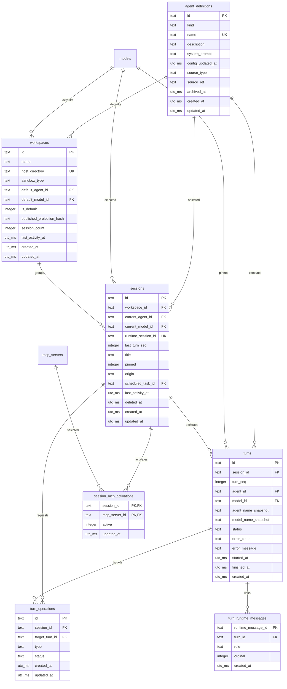
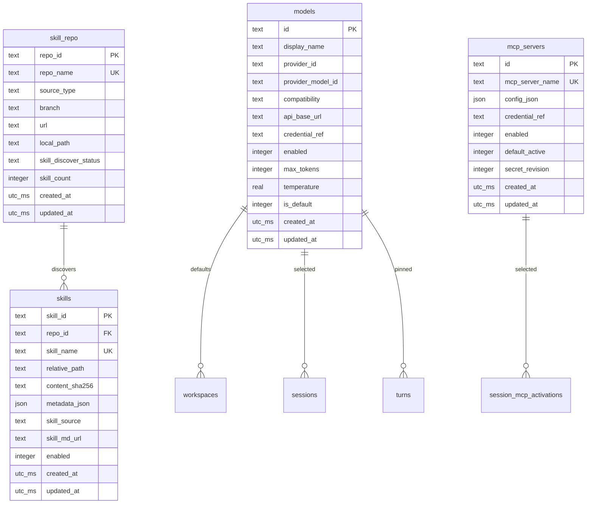
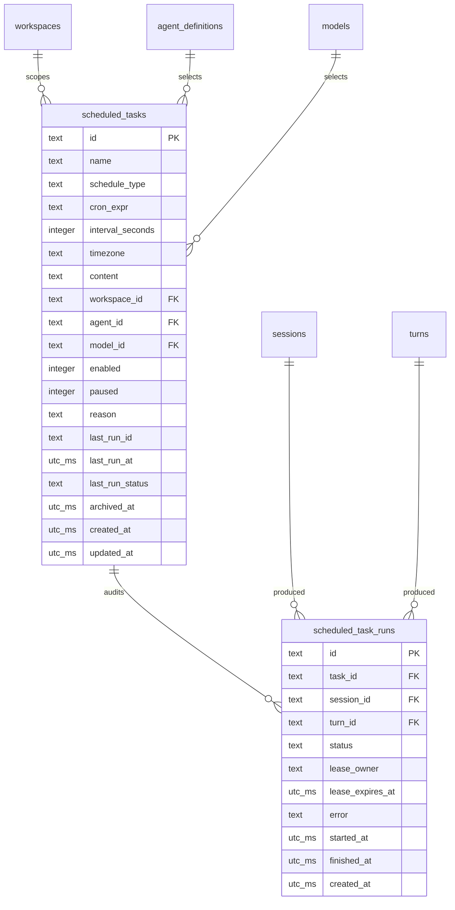
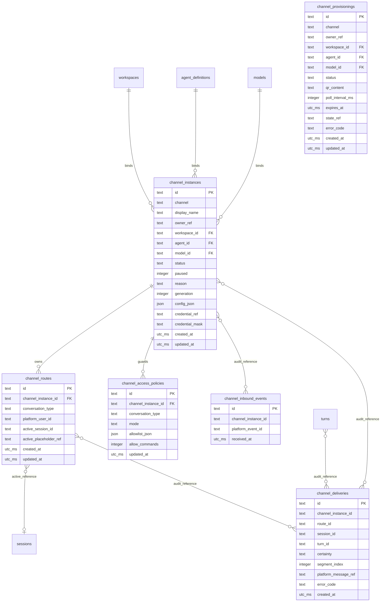

# Witty-Service 完整数据库模型设计

> 状态：Draft（M0 / C02 schema Draft；M1 只把核心对话 7 张表标 Verified Frozen）
> 日期：2026-11-08
> 数据库基线：SQLite 3.35+ / SQLAlchemy / Alembic，单一 OpenCode Runtime
> 适用范围：Agent、Workspace、Session、Turn、模型/技能/MCP、定时任务、IM Channel
> 上位设计：[Agent、Session 与 Workspace 演进方案](./agent-session-workspace-evolution-plan.md)

本文是上位方案第 11 节的完整物理设计细化。参考所给 DB 图的表达方式，使用实体表、外键关系和逻辑查询视图三组图表；字段级冗余、索引及删除策略以本文为准。

当前 ORM 与 Alembic baseline 尚未实现，本文是实现和契约测试的目标，不声称已经冻结。待真实实现并完成结构、并发、恢复及 API 契约测试后，状态才能调整为 Verified Frozen；此后任何字段、约束、索引或级联规则变更都必须先提交 mini-ADR，并同步更新 baseline 与约束测试。

## 1. 设计目标与边界

### 1.1 目标

- Session 属于 Workspace，Agent/模型可在同一 Session 中逐 Turn 切换。
- Agent Definition 直接持有 prompt 等配置；Skill 全局启用并对所有 Agent 可见，MCP 按 Session 激活。
- Turn 只保存 Agent/Model 引用及名称快照用于历史归因，不保存或重放执行配置。
- OpenCode 是消息唯一事实源，数据库不保存消息正文或 Tool/Part 副本。
- 所有高频列表有明确索引和稳定游标，所有执行状态有数据库级并发约束。
- 保留定时任务和 Channel 的运行审计，不因实体删除丢失全部排障证据。
- 允许有明确业务收益的冗余，但每个冗余字段必须定义写入时机和一致性边界。

### 1.2 非目标

- 不建立 `messages`、`message_events`、Runtime Server、Team、通用 Outbox 表。
- 不增加用户、租户、组织或 `owner_id`；Channel 的 `owner_ref` 只是外部不透明归属标签。
- 不为假想查询建立物理视图、物化视图或通用 EAV 结构。
- 不在数据库中执行 OpenCode 调用，也不使用长事务覆盖网络请求。
- 不把 Turn Permit、活动 Turn 登记或候选 Workspace 投影持久化到数据库。
- 不建立进程、端口、健康、发布状态、Permit 或 Runtime Home 布局表；这些运行时事实只存在于 Workspace Runtime Manager 内存。
- 数据库与运行时相关只持久化 `workspaces.host_directory`、`sessions.runtime_session_id`、`workspaces.published_projection_hash` 三个值，边界以 [ADR 0002](./adr/0002-workspace-runtime-control-plane-seam.md) 为准。

## 2. 物理设计规范

### 2.1 类型约定

| 逻辑类型 | SQLite 物理类型 | 使用规则 |
| --- | --- | --- |
| `ID` | `TEXT` | 内部统一 UUID 字符串；不使用自增整数暴露业务规模 |
| `TEXT` | `TEXT` | 有业务上限时在应用与必要 CHECK 中共同校验 |
| `BOOL` | `INTEGER` | 只允许 `0/1`，加 CHECK |
| `UTC_MS` | `INTEGER` | Unix Epoch 毫秒，全部表示 UTC；禁止混用本地时间和 naive datetime |
| `JSON_TEXT` | `TEXT` | 写入规范 JSON，表级 `CHECK(json_valid(...))`；不直接保存密钥 |
| `REAL` | `REAL` | 仅用于温度等浮点参数；金额等精确数值不得使用 |

时间统一为 `UTC_MS`，可避免 SQLite naive datetime、时区偏移和字符串精度比较问题。API 层负责与 RFC 3339 互转，比较和游标均使用整数及唯一 ID。

### 2.2 命名与完整性

- 表名使用复数 `snake_case`；既有 `skill_repo` 作为唯一历史保留名称。
- 约束前缀：`pk_`、`uq_`、`fk_`、`ck_`；索引前缀：`ix_`，唯一索引使用 `uq_`。
- 每个连接必须启用 `PRAGMA foreign_keys=ON`；启动时用 `PRAGMA foreign_keys` 读取校验，关闭状态视为启动失败。
- 状态字段使用 `TEXT + CHECK`，不依赖 SQLite ENUM 模拟。
- 每一个枚举、范围、布尔或互斥语义都必须有同名 `ck_<表>_<字段>`；禁止只写“应用校验”而不在数据库落地可判定的约束。布尔字段统一写 `CHECK (<col> IN (0,1))`。
- 可扩展的外部适配器标识（`channel`、`skill_repo.source_type`、`models.compatibility`）由应用注册表校验，避免每增加一种渠道就迁移 CHECK；其余固定枚举一律建 CHECK。
- 引用目录、模型、Agent 等仍被业务使用的记录时采用 `RESTRICT`；优先归档/禁用，不随意硬删除。
- 所有 JSON 字段必须有 `CHECK (json_valid(<col>))`；需要固定顶层类型时追加 `json_type(<col>)` 判断。

### 2.3 SQLite 运行参数

沿用并作为启动契约验证：

```sql
PRAGMA foreign_keys = ON;
PRAGMA journal_mode = WAL;
PRAGMA synchronous = NORMAL;
PRAGMA busy_timeout = 5000;
```

- 所有多表写入使用短事务；OpenCode HTTP、模型请求和文件扫描不得放在事务内。
- Token/Thinking Delta 不写数据库；只在 Turn 准入、Runtime Message 关联和终态等低频边界写入。
- WAL checkpoint 低频执行，不进入流式事件循环。

### 2.4 SQLite 可实施性基线

本文约束必须由 SQLite 直接执行，D01 只照写，不再改约束语义：

- 最低版本 SQLite **3.35.0**：本稿使用 `UPDATE ... RETURNING`（§4.6）需要 3.35+；表达式索引需要 3.9+、部分索引需要 3.8+，均被 3.35 覆盖。启动结构检查必须断言版本不低于该值。
- JSON 约束使用 SQLite JSON1 的 `json_valid` / `json_type`；启动结构检查执行 `SELECT json_valid('{}')`，失败即视为运行环境不满足基线。
- 部分唯一索引、表达式唯一索引、`COLLATE NOCASE`、`DESC` 索引和 `CHECK` 均为 SQLite 原生语法，不使用 PostgreSQL 专有的 `JSONB`、数组、`ENUM`、部分表达式语法或 `DEFERRABLE` 依赖。
- `CHECK` 只能引用本行字段，不得包含子查询、非确定性函数或跨表判断；“至多一个”类规则一律用部分唯一索引实现。
- 部分唯一索引固定为：`uq_agent_definitions_one_primary`、`uq_workspaces_one_default`、`uq_models_single_default`、`uq_turns_one_running`、`uq_turn_operations_one_reverting`、`uq_scheduled_task_runs_one_running`、`uq_channel_provisionings_waiting`；其中 `uq_channel_provisionings_waiting` 同时使用 `COALESCE` 表达式，属于 SQLite 合法的表达式 + 部分唯一索引组合。
- 表达式唯一索引固定为 `uq_models_provider_endpoint_model(provider_id, COALESCE(api_base_url,''), provider_model_id)` 与 `uq_channel_provisionings_waiting(channel, COALESCE(owner_ref,''))`；表达式必须是确定性的，禁止在索引中调用时间函数或应用函数。
- 本文 CHECK 只使用 `IN`、`IS NULL`、`>=`、`BETWEEN` 语义与布尔组合，以及 `json_valid/json_type`；不写跨行子查询、窗口函数或触发器式判断。
- `COLLATE NOCASE` 只折叠 ASCII 大小写；非 ASCII 名称按原值比较。名称统一在应用层 `trim` 后写入，数据库唯一约束负责最终兜底。
- 所有时间字段只存 `UTC_MS` 整数；禁止 `DATETIME`、本地时区字符串或浮点秒。
- 建表顺序遵循 §13；启用 `PRAGMA foreign_keys=ON` 后，父表先于子表创建，baseline 结束时执行 `PRAGMA foreign_key_check`。

## 3. 表总览

| 分组 | 表 | 数量（提示） |
| --- | --- | ---: |
| 核心对话 | `agent_definitions`、`workspaces`、`sessions`、`session_mcp_activations`、`turns`、`turn_operations`、`turn_runtime_messages` | 7 |
| 能力目录 | `models`、`skill_repo`、`skills`、`mcp_servers` | 4 |
| 定时任务 | `scheduled_tasks`、`scheduled_task_runs` | 2 |
| IM Channel | `channel_instances`、`channel_provisionings`、`channel_routes`、`channel_inbound_events`、`channel_deliveries`、`channel_access_policies` | 6 |
| **合计（仅提示）** | **7 + 4 + 2 + 6** | **19** |

`alembic_version` 属于迁移基础设施，不计入业务表。验收以本表逐项枚举为准，数量只作提示，不为凑数增删表。

## 4. 核心对话模型

### 4.1 ER 图



> `turns.agent_id` 与 `turns.model_id` 是指向目录的单列外键；两个名称快照只用于历史展示和归因。Turn 不保存 prompt、模型参数、Skill/MCP 配置或工具集，重跑与重生成均重新解析现行配置。

### 4.2 `agent_definitions`

| 字段 | 类型 | 空值/默认 | 约束与说明 |
| --- | --- | --- | --- |
| `id` | ID | NOT NULL | PK |
| `kind` | TEXT | NOT NULL | `primary/expert` |
| `name` | TEXT | NOT NULL | `COLLATE NOCASE`；唯一约束见 `uq_agent_definitions_name`；创建前 trim，归档后仍保留名称 |
| `description` | TEXT | NOT NULL `''` | 展示描述 |
| `system_prompt` | TEXT | NOT NULL `''` | 该 Agent 的系统提示词唯一事实源，直接存本表 |
| `config_updated_at` | UTC_MS | NOT NULL | 配置最后变更时间；**乐观锁**字段，同一 Agent 内严格递增 |
| `source_type` | TEXT | NOT NULL `'local'` | `local/market/preset` |
| `source_ref` | TEXT | NULL | 市场/预置来源标识；本地来源可为空 |
| `archived_at` | UTC_MS | NULL | 归档后禁止新选择与新 Turn，历史 Turn 与名称快照保留 |
| `created_at` | UTC_MS | NOT NULL | 创建时间 |
| `updated_at` | UTC_MS | NOT NULL | 元数据/配置变更时间 |

约束与索引：

- `ck_agent_definitions_kind`：`kind IN ('primary','expert')`。
- `ck_agent_definitions_source_type`：`source_type IN ('local','market','preset')`。
- `uq_agent_definitions_name(name)`，列使用 `COLLATE NOCASE`。
- `uq_agent_definitions_one_primary ON kind WHERE kind='primary' AND archived_at IS NULL`，同一时刻至多一个未归档 Primary。
- `ix_agent_definitions_catalog(kind, archived_at, name)`。
- 无外键；Agent Definition 不反向依赖 Workspace/Session。
- 名称、描述、prompt、来源等 Definition 变更时，同事务推进 `config_updated_at`；其值取 `MAX(:now_ms, config_updated_at + 1)` 保证严格递增。
- 并发编辑使用 `WHERE id=:id AND config_updated_at=:expected` 条件更新，受影响行数为 0 即冲突。
- Primary 由种子创建，不归档、不删除；Expert 只归档，不做物理删除。

### 4.3 `workspaces`

| 字段 | 类型 | 空值/默认 | 约束与说明 |
| --- | --- | --- | --- |
| `id` | ID | NOT NULL | PK |
| `name` | TEXT | NOT NULL | 侧栏展示名 |
| `host_directory` | TEXT | NOT NULL | 规范化并解析符号链接后的宿主目录；**创建后不可变**；唯一约束见 `uq_workspaces_host_directory` |
| `sandbox_type` | TEXT | NOT NULL | `local/docker` |
| `default_agent_id` | ID | NOT NULL | FK → `agent_definitions.id`，RESTRICT |
| `default_model_id` | ID | NULL | FK → `models.id`，RESTRICT；未配置模型时为空 |
| `is_default` | BOOL | NOT NULL `0` | 是否默认 Workspace |
| `published_projection_hash` | TEXT | NULL | 最近一次成功发布的确定性非密投影 hash；首次发布前为空 |
| `session_count` | INTEGER | NOT NULL `0` | **冗余**：未删除 Session 数，`>=0` |
| `last_activity_at` | UTC_MS | NOT NULL | **冗余**：侧栏排序，创建时等于 `created_at` |
| `created_at` | UTC_MS | NOT NULL | 创建时间 |
| `updated_at` | UTC_MS | NOT NULL | 元数据修改时间 |

约束与索引：

- `ck_workspaces_sandbox_type`：`sandbox_type IN ('local','docker')`。
- `ck_workspaces_is_default`：`is_default IN (0,1)`。
- `ck_workspaces_session_count`：`session_count >= 0`。
- `uq_workspaces_host_directory(host_directory)`。
- `uq_workspaces_one_default ON is_default WHERE is_default=1`。
- `ix_workspaces_sidebar(is_default DESC, last_activity_at DESC, id DESC)`，支撑侧栏 keyset。
- `host_directory` 创建时规范化并解析符号链接，写入后不可 UPDATE；如需迁移目录必须新建 Workspace。数据库只保存该宿主目录，进程、端口、健康、Permit、发布状态和 Runtime Home 布局均在 Manager 内存，见 §2.4 与 ADR 0002。
- `session_count` 在 Session 创建和设置 `deleted_at` 的事务中各调整一次；后续硬删除不重复扣减，不随 Turn 更新。
- `last_activity_at` 仅在 Session 创建和 Turn 终态通过 `MAX(last_activity_at, :activity_at)` 原子更新，不按 Token 更新，也避免并发终态使时间倒退。
- 数据库只持久化已发布 hash；候选投影和发布协调状态由 Runtime Manager 在内存中管理。完整投影与发布规则见第 8 节。

### 4.4 `sessions`

| 字段 | 类型 | 空值/默认 | 约束与说明 |
| --- | --- | --- | --- |
| `id` | ID | NOT NULL | PK |
| `workspace_id` | ID | NOT NULL | FK → Workspace，RESTRICT；创建后不可变 |
| `current_agent_id` | ID | NOT NULL | FK → Agent Definition，RESTRICT |
| `current_model_id` | ID | NULL | FK → Model，RESTRICT；为空时禁止创建 Turn |
| `runtime_session_id` | TEXT | NULL | OpenCode Session ID；首个 Turn 前可为空；唯一约束见 `uq_sessions_runtime_session_id` |
| `last_turn_seq` | INTEGER | NOT NULL `0` | **冗余**：最后已分配的 Turn 序号，`>=0` |
| `title` | TEXT | NULL | 展示标题 |
| `pinned` | BOOL | NOT NULL `0` | 是否置顶 |
| `origin` | TEXT | NOT NULL `'web'` | `web/channel/scheduled` |
| `scheduled_task_id` | ID | NULL | FK → Scheduled Task，RESTRICT；Task 仅归档 |
| `last_activity_at` | UTC_MS | NOT NULL | 侧栏排序，创建/终态时更新 |
| `deleted_at` | UTC_MS | NULL | 删除准入标记；设置后禁止新 Turn |
| `created_at` | UTC_MS | NOT NULL | 创建时间 |
| `updated_at` | UTC_MS | NOT NULL | 当前选择/元数据更新时间 |

约束与索引：

- `ck_sessions_origin`：`origin IN ('web','channel','scheduled')`。
- `ck_sessions_scheduled_origin`：`(origin='scheduled' AND scheduled_task_id IS NOT NULL) OR (origin<>'scheduled' AND scheduled_task_id IS NULL)`；Scheduled Task 只归档，避免来源外键被清空后破坏该约束。
- `ck_sessions_last_turn_seq`：`last_turn_seq >= 0`。
- `ck_sessions_pinned`：`pinned IN (0,1)`。
- `uq_sessions_runtime_session_id(runtime_session_id)`，允许任意多行 NULL。
- `ix_sessions_workspace_sidebar(workspace_id, deleted_at, pinned DESC, last_activity_at DESC, id DESC)`。
- `ix_sessions_scheduled_task(scheduled_task_id, created_at DESC)`。
- `workspace_id` 创建后不可变；`current_agent_id/current_model_id` 只影响下一 Turn，不改写历史 Turn。
- 不保存 Session 级 running/error；活动性由 Turn 推导。

### 4.5 `session_mcp_activations`

| 字段 | 类型 | 空值/默认 | 约束与说明 |
| --- | --- | --- | --- |
| `session_id` | ID | NOT NULL | PK/FK → `sessions.id`，CASCADE |
| `mcp_server_id` | ID | NOT NULL | PK/FK → `mcp_servers.id`，RESTRICT |
| `active` | BOOL | NOT NULL | 该 Session 是否激活此 MCP |
| `updated_at` | UTC_MS | NOT NULL | 激活状态最后变更时间 |

约束与索引：

- PK：`(session_id, mcp_server_id)`。
- `ck_session_mcp_activations_active`：`active IN (0,1)`。
- `ix_session_mcp_activations_server(mcp_server_id, session_id)`，支撑反查与 RESTRICT 外键检查。
- Session 创建事务内，对当时所有 `enabled=1` 的 MCP 执行 `INSERT ... SELECT`，以 `mcp_servers.default_active` 初始化 `active`；因此默认关闭的 MCP 也有显式初始行。
- `default_active` 后续变更只影响新 Session，不回填或更新已有 Session。新增 MCP 不向已有 Session 补行，缺失行一律按未激活处理；用户显式激活时才 upsert。
- Runtime 有效 MCP 集合必须同时满足 `mcp_servers.enabled=1`、激活行存在且 `active=1`、Runtime 连接状态为 ready。connecting/degraded 等非 ready 工具不得暴露给本轮推理；ready 是运行时状态，不回写 Activation。禁用 MCP 不删除激活行，重新启用后仍受原 Session 激活状态约束。

### 4.6 `turns`

| 字段 | 类型 | 空值/默认 | 约束与说明 |
| --- | --- | --- | --- |
| `id` | ID | NOT NULL | PK |
| `session_id` | ID | NOT NULL | FK → Session，CASCADE |
| `turn_seq` | INTEGER | NOT NULL | Session 内序号，`>=1` |
| `agent_id` | ID | NOT NULL | FK → `agent_definitions.id`，RESTRICT |
| `model_id` | ID | NOT NULL | FK → Model，RESTRICT |
| `agent_name_snapshot` | TEXT | NOT NULL | 最终准入事务读取的 Agent Definition 展示名，仅用于历史归因 |
| `model_name_snapshot` | TEXT | NOT NULL | 最终准入事务读取的 Model 展示名，仅用于历史归因 |
| `status` | TEXT | NOT NULL `'running'` | `running/completed/error/interrupted` |
| `error_code` | TEXT | NULL | 稳定机器错误码 |
| `error_message` | TEXT | NULL | 可展示错误摘要，不保存敏感请求 |
| `started_at` | UTC_MS | NOT NULL | 开始时间 |
| `finished_at` | UTC_MS | NULL | 终态时间 |
| `created_at` | UTC_MS | NOT NULL | 创建时间 |

约束与索引：

- `ck_turns_turn_seq`：`turn_seq >= 1`。
- `ck_turns_status`：`status IN ('running','completed','error','interrupted')`。
- `ck_turns_terminal_time`：`(status='running' AND finished_at IS NULL) OR (status<>'running' AND finished_at IS NOT NULL)`。
- `uq_turns_session_seq(session_id, turn_seq)`；反向扫描同时支撑 Turn 列表，不再建立重复索引。
- `uq_turns_one_running ON session_id WHERE status='running'`。
- `ix_turns_agent(agent_id, created_at DESC)`，仅用于 Agent 维度审计/排障。
- 每个 Session 仅允许一个 running Turn；不同 Session 可并发执行。
- Turn 表不存 prompt、模型参数、Skill/MCP 配置、工具集或 Workspace ID；重生成协调只在 `turn_operations`，Turn 不设自引用重生成字段。

Turn Permit 是 Runtime Manager 的内存机制，不建表、不写字段。Runtime Manager 在发放 Permit 前确认 Workspace 最新投影，并在同一内存临界区原子登记活动 Turn。需要发布投影时，按 Workspace 暂停发放新 Permit，等待活动 Turn 自然到达终态后发布，再恢复准入；不得为了发布自动 abort 在飞 Turn。进程崩溃后内存登记直接清空，由恢复流程对账数据库和 Runtime。

取得 Permit 不代表可以省略数据库校验。普通 Turn 的最终准入事务必须重新确认 Session 未删除、当前 Agent 未归档、当前模型存在且 enabled，并同事务分配序号、写入两个名称快照和 running Turn。名称取自同一事务读取的目录记录；显示名不属于 Runtime 投影。数据库负责 `turn_seq` 唯一和每 Session 一个 running 等约束，不负责 Permit 或发布协调。

最终准入使用同一短事务分配序号并插入记录：

```sql
UPDATE sessions
SET last_turn_seq = last_turn_seq + 1,
    updated_at = :now_ms
WHERE id = :session_id
  AND deleted_at IS NULL
RETURNING last_turn_seq;
```

返回值为本次 `turn_seq`，同事务插入 `turns`。无返回行表示 Session 不存在或正在删除。数据库写入失败必须释放内存活动登记；不得在事务内执行 OpenCode 请求。

### 4.7 `turn_operations`

| 字段 | 类型 | 空值/默认 | 约束与说明 |
| --- | --- | --- | --- |
| `id` | ID | NOT NULL | PK |
| `session_id` | ID | NOT NULL | FK → Session，CASCADE |
| `target_turn_id` | ID | NOT NULL | FK → Turn，CASCADE；应用校验与 Session 一致 |
| `type` | TEXT | NOT NULL `'regenerate'` | CHECK 仅允许 `regenerate` |
| `status` | TEXT | NOT NULL `'reverting'` | `reverting/accepted/failed/interrupted` |
| `created_at` | UTC_MS | NOT NULL | 操作创建时间 |
| `updated_at` | UTC_MS | NOT NULL | 操作状态最后变更时间 |

约束与索引：

- `ck_turn_operations_type`：`type IN ('regenerate')`。
- `ck_turn_operations_status`：`status IN ('reverting','accepted','failed','interrupted')`。
- `uq_turn_operations_one_reverting ON session_id WHERE status='reverting'`，防止同一 Session 并发重复 revert。
- `ix_turn_operations_target(target_turn_id)`，支撑目标外键检查。
- `ix_turn_operations_session_created(session_id, created_at DESC, id DESC)`，支撑恢复与排障。
- 状态推进使用 `WHERE id=:id AND status='reverting'` 条件更新；该表不存用户输入、回复正文、配置或 Runtime Message，也不是第二历史源。

重生成流程：

1. 在同一 Session 的串行预检中确认目标是 `turn_seq` 最大的最新 Turn，且当前没有 running Turn；非最新目标返回 `409 INVALID_TURN_OPERATION`。
2. 执行身份使用原 Turn `agent_id` 指向 Agent 的最新配置，以及 Session 当前 `current_model_id`。只有原 Turn Agent 已归档才因 Agent 归档拒绝；Session 当前 Agent 已归档不影响原 Agent 仍可用时的重生成。当前模型必须存在且 enabled。
3. 先插入 `reverting` 操作，再在数据库事务外调用 OpenCode revert。已知 revert 或后续提交失败时将操作标为 `failed`；Runtime 接受新 Turn 后将操作标为 `accepted`。新 Turn 是普通 `turns` 行，两个名称快照取最终准入事务中的原 Turn Agent 最新目录记录与 Session 当前 Model。
4. 不增加 `reverted` 或 `superseded` Turn 状态。原目标 Turn 保持原终态，OpenCode 可见历史仍是消息事实源，操作行只描述重生成协调过程。
5. revert 后发生进程崩溃时，恢复流程不得根据 `reverting` 假定 revert 已发生，也不得假定新 Turn 已被接受。必须先对账 Runtime 可见历史、Turn 与 Runtime Message Mapping，再修复 Session `last_turn_seq` 读模型；遗留 `reverting` 操作标为 `interrupted`，不自动重放用户输入，由用户重新输入。

`last_turn_seq` 修复以完成领域对账后的 `turns` 为准，重算为该 Session 的 `COALESCE(MAX(turn_seq),0)` 并校验序号唯一性；不得因为 Runtime revert 而物理删除原 Turn 或回退已经使用的序号。

### 4.8 `turn_runtime_messages`

| 字段 | 类型 | 空值/默认 | 约束与说明 |
| --- | --- | --- | --- |
| `runtime_message_id` | TEXT | NOT NULL | PK，OpenCode Message ID |
| `turn_id` | ID | NOT NULL | FK → Turn，CASCADE |
| `role` | TEXT | NOT NULL | `user/assistant` |
| `ordinal` | INTEGER | NOT NULL | Turn 内顺序，`>=0` |
| `created_at` | UTC_MS | NOT NULL | 关联创建时间，不作为历史游标 |

约束与索引：

- `ck_turn_runtime_messages_role`：`role IN ('user','assistant')`。
- `ck_turn_runtime_messages_ordinal`：`ordinal >= 0`。
- `uq_turn_runtime_messages_turn_ordinal(turn_id, ordinal)`，同时支撑 Turn 内正序/反序读取。
- `ix_turn_runtime_messages_turn(turn_id)` 不必重复创建，以上唯一索引已覆盖。
- Tool/Part、正文、附件内容不进入数据库。
- Runtime 历史分页只使用 OpenCode 游标；该表仅补充 Turn 归属和展示元数据。

### 4.9 Turn 名称快照的历史归因

`agent_name_snapshot`、`model_name_snapshot` 是有意的最小历史冗余：Agent 或模型后续改名时，旧 Turn 仍显示执行时名称，同时避免历史投影为每条消息回查目录。两个字段在 Turn 准入时写入，之后不可变。

名称快照不回答配置版本，也不参与执行。重跑、续跑和重生成均按本文字段规则重新解析配置；prompt、模型参数、Skill 内容、MCP 配置、工具集和凭据均不复制到 Turn。

### 4.10 核心对话 7 表收口核对

本节只做 C02-1 的边界核对，不新增语义。每个字段均可在演进方案 §1 的决策表与 §8 的数据模型原则中找到依据。

| 表 | 收口结论 | 演进方案依据 |
| --- | --- | --- |
| `agent_definitions` | 单层定义，只含名称、描述、prompt、来源、归档时间和 `config_updated_at`；不含默认模型、能力绑定或配置版本 | §1 “Agent 编辑”、§8 原则 |
| `workspaces` | Workspace 只保存目录、默认值、聚合计数和单一 `published_projection_hash`；无候选版本、dirty 标记或配置代次 | §1 “Runtime 投影”、§8 原则 |
| `sessions` | Workspace 所有权 + 当前 Agent/模型 + `runtime_session_id` + 删除准入；无活动 Turn 指针、无 Session 级执行状态 | §1 “Session 当前值”、§8 原则 |
| `session_mcp_activations` | 只保存 Session 级激活二元组；默认值只影响新 Session | §1 “MCP”、§8 原则 |
| `turns` | 只有 `agent_id`、`model_id` 和两个名称快照，加序号、状态、错误与时间；无执行配置、无自引用重生成字段、无 Workspace ID | §1 “Turn 归因”、§8 原则 |
| `turn_operations` | 只保存重生成协调状态，不是消息或配置事实源；不存正文 | §1 “重生成”、§8 原则 |
| `turn_runtime_messages` | 只保存 Runtime Message 归属与展示元数据；正文、Part、Tool 不落库 | §1 “历史”、§8 原则 |

Agent 级能力绑定表、Workspace 级能力绑定表、执行环境快照表、配置代次字段和活动 Turn 指针均不进入正式表结构；删除结论只在 §15 记录。

以上 7 张表当前状态均为 **Draft**。只有 D01/D02/D08 完成且 §14.1–§14.3 的真实结构、并发和级联测试通过后，才允许在表标题追加 `Verified Frozen`；M0 阶段不得提前标记。

## 5. 能力目录模型

### 5.1 ER 图



### 5.2 `models`

| 字段 | 类型 | 空值/默认 | 约束与说明 |
| --- | --- | --- | --- |
| `id` | ID | NOT NULL | PK，Session/Turn 引用的 catalog ID |
| `display_name` | TEXT | NOT NULL | 用户展示名 |
| `provider_id` | TEXT | NOT NULL | OpenCode providerID |
| `provider_model_id` | TEXT | NOT NULL | OpenCode modelID，与展示名分离 |
| `compatibility` | TEXT | NULL | `openai/anthropic` 等协议兼容标识 |
| `api_base_url` | TEXT | NULL | 自定义 Endpoint |
| `credential_ref` | TEXT | NULL | 0600 Secret Store 引用；不存明文 API Key |
| `enabled` | BOOL | NOT NULL `1` | 禁用后禁止普通新 Turn 与重生成 |
| `max_tokens` | INTEGER | NOT NULL `32768` | `>0` |
| `temperature` | REAL | NOT NULL `0.7` | 修正旧 Integer 类型，`0.0–2.0` |
| `is_default` | BOOL | NOT NULL `0` | 全局默认模型 |
| `created_at` | UTC_MS | NOT NULL | 创建时间 |
| `updated_at` | UTC_MS | NOT NULL | 修改时间 |

约束与索引：

- `ck_models_enabled`：`enabled IN (0,1)`。
- `ck_models_is_default`：`is_default IN (0,1)`。
- `ck_models_max_tokens`：`max_tokens > 0`。
- `ck_models_temperature`：`temperature >= 0.0 AND temperature <= 2.0`。
- `uq_models_provider_endpoint_model(provider_id, COALESCE(api_base_url,''), provider_model_id)`，使用表达式唯一索引。
- `uq_models_single_default ON is_default WHERE is_default=1`。
- `ix_models_catalog(enabled, is_default DESC, created_at DESC, id)`。
- 无外键；被 Workspace/Session/Turn/Scheduler/Channel 引用，自身不引用其他业务表。
- `compatibility` 是可扩展协议标识，由应用注册表校验，不建 CHECK。
- 被 Workspace/Session/Turn/Scheduler/Channel 引用时禁止硬删除，改为 `enabled=0`。
- 默认模型必须 enabled，由同一应用事务保证；禁用后的 Workspace 默认值回退见第 10 节。

### 5.3 `skill_repo`

| 字段 | 类型 | 空值/默认 | 约束与说明 |
| --- | --- | --- | --- |
| `repo_id` | ID | NOT NULL | PK |
| `repo_name` | TEXT | NOT NULL | `COLLATE NOCASE`；唯一约束见 `uq_skill_repo_repo_name`，修复重名竞态 |
| `source_type` | TEXT | NOT NULL | 应用注册表校验：builtin/git/local/clawhub/wittyhub |
| `branch` | TEXT | NULL | Git 分支 |
| `url` | TEXT | NULL | 远程来源 |
| `local_path` | TEXT | NULL | 本地来源 |
| `skill_discover_status` | TEXT | NOT NULL `'init'` | `init/discovering/ready/error` |
| `skill_count` | INTEGER | NOT NULL `0` | **冗余**：发现成功的 Skill 数，`>=0` |
| `created_at` | UTC_MS | NOT NULL | 创建时间 |
| `updated_at` | UTC_MS | NOT NULL | 修改时间 |

约束与索引：

- `ck_skill_repo_skill_discover_status`：`skill_discover_status IN ('init','discovering','ready','error')`。
- `ck_skill_repo_skill_count`：`skill_count >= 0`。
- `uq_skill_repo_repo_name(repo_name)`，列使用 `COLLATE NOCASE`。
- `source_type` 是应用注册表标识（builtin/git/local/clawhub/wittyhub），不建 CHECK。
- `ix_skill_repo_status(skill_discover_status, updated_at)`。
- 无外键；来源是根实体，Skill 通过 `skills.repo_id` RESTRICT 引用。
- `skill_count` 在 Skill 同步事务中重算或调整；发现流程允许重建，不作为可见性判断依据。
- 被 Skills 引用时采用 RESTRICT；先归档来源，不直接级联抹除已引用能力。

### 5.4 `skills`

| 字段 | 类型 | 空值/默认 | 约束与说明 |
| --- | --- | --- | --- |
| `skill_id` | ID | NOT NULL | PK |
| `repo_id` | ID | NOT NULL | FK → `skill_repo`，RESTRICT；内建 Skill 使用内建来源记录 |
| `skill_name` | TEXT | NOT NULL | `COLLATE NOCASE`；唯一约束见 `uq_skills_skill_name`，与 OpenCode Skill 名一致 |
| `relative_path` | TEXT | NOT NULL | 来源内相对路径，禁止绝对路径和 `..` |
| `content_sha256` | TEXT | NOT NULL | 当前 Skill 内容摘要，进入 Workspace 投影 hash |
| `metadata_json` | JSON_TEXT | NOT NULL `'{}'` | 非密元数据 |
| `skill_source` | TEXT | NULL | 原始来源说明 |
| `skill_md_url` | TEXT | NULL | 文档地址 |
| `enabled` | BOOL | NOT NULL `1` | 全局开关；enabled 的 Skill 对所有 Agent 可见并进入全量投影 |
| `created_at` | UTC_MS | NOT NULL | 创建时间 |
| `updated_at` | UTC_MS | NOT NULL | 修改时间 |

约束与索引：

- `ck_skills_enabled`：`enabled IN (0,1)`。
- `ck_skills_metadata_json`：`json_valid(metadata_json)`。
- `uq_skills_skill_name(skill_name)`，列使用 `COLLATE NOCASE`。
- `uq_skills_repo_path(repo_id, relative_path)`。
- `ix_skills_enabled_name(enabled, skill_name)`。
- `relative_path` 的绝对路径与 `..` 拒绝属于应用与路径 API 校验，不建 CHECK：SQLite CHECK 无法可靠覆盖跨平台路径语义，D01 不为它增加数据库约束。
- 所有 Skill 必须属于来源，消除旧设计中 `repo_id=NULL` 导致的唯一约束绕过。
- Skill 的可见性只由全局 `enabled` 决定；`enabled=0` 在下一轮全量投影中全局移除。内容更新必须同步更新摘要，不改变任何历史 Turn。

### 5.5 `mcp_servers`

| 字段 | 类型 | 空值/默认 | 约束与说明 |
| --- | --- | --- | --- |
| `id` | ID | NOT NULL | PK |
| `mcp_server_name` | TEXT | NOT NULL | `COLLATE NOCASE`；唯一约束见 `uq_mcp_servers_mcp_server_name` |
| `config_json` | JSON_TEXT | NOT NULL | 传输、命令、Endpoint 等非密配置 |
| `credential_ref` | TEXT | NULL | Token、Header 等秘密的 Secret Store 引用 |
| `enabled` | BOOL | NOT NULL `1` | 禁用后退出下一轮 Workspace 投影，Runtime 不得激活 |
| `default_active` | BOOL | NOT NULL `0` | 仅决定新 Session 的初始激活状态 |
| `secret_revision` | INTEGER | NOT NULL `0` | 凭据修订号，`>=0`，每次凭据写入、替换或移除时递增 |
| `created_at` | UTC_MS | NOT NULL | 创建时间 |
| `updated_at` | UTC_MS | NOT NULL | 修改时间 |

约束与索引：

- `ck_mcp_servers_enabled`：`enabled IN (0,1)`。
- `ck_mcp_servers_default_active`：`default_active IN (0,1)`。
- `ck_mcp_servers_secret_revision`：`secret_revision >= 0`。
- `ck_mcp_servers_config_json`：`json_valid(config_json)`。
- `uq_mcp_servers_mcp_server_name(mcp_server_name)`，列使用 `COLLATE NOCASE`。
- `ix_mcp_servers_enabled_name(enabled, mcp_server_name)`。
- 无外键；全局 MCP 目录，Session 通过 Activation 引用。
- 被 Session Activation 等引用时禁止硬删除，只能 `enabled=0`。
- 密钥必须在写入边界从 `config_json` 提取到 Secret Store，不能仅依赖前端不传。Secret Store 写入成功后，再在一个数据库事务中更新 `credential_ref` 并递增 `secret_revision`；失败不得推进修订号。
- 非密 `config_json`、工具集摘要和 `secret_revision` 进入 Workspace 投影 hash。`credential_ref` 仅供运行时解析，凭据明文和 Secret 内容不得进入 hash 或日志。

## 6. 定时任务模型

### 6.1 ER 图



### 6.2 `scheduled_tasks`

| 字段 | 类型 | 空值/默认 | 约束与说明 |
| --- | --- | --- | --- |
| `id` | ID | NOT NULL | PK |
| `name` | TEXT | NOT NULL | 展示名 |
| `schedule_type` | TEXT | NOT NULL | `cron/interval` |
| `cron_expr` | TEXT | NULL | Cron 表达式 |
| `interval_seconds` | INTEGER | NULL | 间隔秒数，`>0` |
| `timezone` | TEXT | NOT NULL | IANA 时区，仅调度计算使用；存储时间仍为 UTC_MS |
| `content` | TEXT | NOT NULL | 每次提交给 Turn 的任务输入 |
| `workspace_id` | ID | NOT NULL | FK → Workspace，RESTRICT |
| `agent_id` | ID | NOT NULL | FK → Agent Definition，RESTRICT |
| `model_id` | ID | NOT NULL | FK → Model，RESTRICT |
| `enabled` | BOOL | NOT NULL `1` | 用户是否启用调度 |
| `paused` | BOOL | NOT NULL `0` | 依赖失效等导致调度暂停；暂停时不创建 Run |
| `reason` | TEXT | NULL | 暂停原因，如 `agent_archived/model_disabled` |
| `last_run_id` | ID | NULL | **冗余**：最近 Run ID；审计引用，不设 FK 以避免循环依赖 |
| `last_run_at` | UTC_MS | NULL | **冗余**：最近运行创建时间 |
| `last_run_status` | TEXT | NULL | **冗余**：最近运行状态 |
| `archived_at` | UTC_MS | NULL | 归档后停止调度但保留 Runs |
| `created_at` | UTC_MS | NOT NULL | 创建时间 |
| `updated_at` | UTC_MS | NOT NULL | 修改时间 |

约束与索引：

- `ck_scheduled_tasks_schedule_type`：`schedule_type IN ('cron','interval')`。
- `ck_scheduled_tasks_schedule`：`(schedule_type='cron' AND cron_expr IS NOT NULL AND interval_seconds IS NULL) OR (schedule_type='interval' AND interval_seconds IS NOT NULL AND cron_expr IS NULL)`。
- `ck_scheduled_tasks_interval_seconds`：`interval_seconds IS NULL OR interval_seconds > 0`。
- `ck_scheduled_tasks_enabled`：`enabled IN (0,1)`。
- `ck_scheduled_tasks_paused`：`paused IN (0,1)`。
- `ck_scheduled_tasks_pause`：`(paused=0 AND reason IS NULL) OR (paused=1 AND reason IS NOT NULL)`。
- `ck_scheduled_tasks_last_run`：`(last_run_id IS NULL AND last_run_at IS NULL AND last_run_status IS NULL) OR (last_run_id IS NOT NULL AND last_run_at IS NOT NULL AND last_run_status IN ('running','succeeded','failed','skipped'))`。
- `ck_scheduled_tasks_archived`：`archived_at IS NULL OR archived_at >= created_at`。
- `ix_scheduled_tasks_enabled(enabled, paused, archived_at, updated_at)`。
- `ix_scheduled_tasks_workspace(workspace_id, archived_at, updated_at DESC)`。
- Agent 归档或 Model 禁用时，同事务将引用它的 Task 置为 `paused=1` 并写 `reason`，不删除 Task、不清空绑定。恢复必须在显式重选未归档 Agent 和 enabled Model 的同一事务中清除 `paused/reason`，依赖恢复本身不自动解除暂停。
- `last_run_id/last_run_at/last_run_status` 在 Run 创建和终态事务中更新，避免任务列表逐任务查询最新 Run；仅当当前摘要为空，或 `(run.created_at, run.id) >= (task.last_run_at, task.last_run_id)` 时才允许更新。相同 Run 可推进状态，较旧 Run 的迟到终态不得覆盖较新 Run 摘要。

### 6.3 `scheduled_task_runs`

| 字段 | 类型 | 空值/默认 | 约束与说明 |
| --- | --- | --- | --- |
| `id` | ID | NOT NULL | PK |
| `task_id` | ID | NOT NULL | FK → Task，RESTRICT；保留审计 |
| `session_id` | ID | NULL | FK → Session，SET NULL |
| `turn_id` | ID | NULL | FK → Turn，SET NULL |
| `status` | TEXT | NOT NULL `'running'` | `running/succeeded/failed/skipped` |
| `lease_owner` | TEXT | NULL | 当前服务实例 ID，用于条件更新 |
| `lease_expires_at` | UTC_MS | NULL | 租约到期时间；替代不利索引的时间表达式 |
| `error` | TEXT | NULL | 错误摘要 |
| `started_at` | UTC_MS | NULL | 实际开始时间 |
| `finished_at` | UTC_MS | NULL | 终态时间 |
| `created_at` | UTC_MS | NOT NULL | 创建时间 |

约束与索引：

- `ck_scheduled_task_runs_status`：`status IN ('running','succeeded','failed','skipped')`。
- `ck_scheduled_task_runs_lease`：`status<>'running' OR (lease_owner IS NOT NULL AND lease_expires_at IS NOT NULL)`。
- `uq_scheduled_task_runs_one_running ON task_id WHERE status='running'`，数据库级防止同一任务重入。
- `ix_scheduled_task_runs_task_created(task_id, created_at DESC, id DESC)`。
- `ix_scheduled_task_runs_global_created(created_at DESC, id DESC)`。
- `ix_scheduled_task_runs_session(session_id, created_at DESC)`。
- `ix_scheduled_task_runs_turn(turn_id)`，支撑 Turn/Session 清理时的 SET NULL 外键动作。
- `ix_scheduled_task_runs_lease(status, lease_expires_at)`。
- running 时 `lease_owner`、`lease_expires_at` 必须非空，避免无租约记录永久占用任务。
- 终态更新必须使用 `WHERE id=? AND status='running' AND lease_owner=?` 条件更新，并检查受影响行数，禁止无条件覆盖终态。
- 租约过期的 running Run 可被恢复流程接管；接管同样是条件更新。

## 7. IM Channel 模型

### 7.1 ER 图



### 7.2 `channel_instances`

| 字段 | 类型 | 空值/默认 | 约束与说明 |
| --- | --- | --- | --- |
| `id` | ID | NOT NULL | PK |
| `channel` | TEXT | NOT NULL | 应用适配器注册表标识 |
| `display_name` | TEXT | NULL | 展示名 |
| `owner_ref` | TEXT | NULL | 外部不透明归属标签，不用于鉴权 |
| `workspace_id` | ID | NULL | FK → Workspace，RESTRICT |
| `agent_id` | ID | NULL | FK → Agent Definition，RESTRICT |
| `model_id` | ID | NULL | FK → Model，RESTRICT |
| `status` | TEXT | NOT NULL `'pending'` | `pending/connected/degraded/offline/error/disabled`，表示连接状态 |
| `paused` | BOOL | NOT NULL `0` | 依赖失效等导致业务暂停；暂停时不创建新 Turn |
| `reason` | TEXT | NULL | 暂停原因，如 `agent_archived/model_disabled` |
| `generation` | INTEGER | NOT NULL `1` | Channel 实例世代，`>=1` |
| `config_json` | JSON_TEXT | NOT NULL `'{}'` | 非密运行配置 |
| `credential_ref` | TEXT | NULL | Secret Store 引用 |
| `credential_mask` | TEXT | NULL | 展示用掩码 |
| `created_at` | UTC_MS | NOT NULL | 创建时间 |
| `updated_at` | UTC_MS | NOT NULL | 修改时间 |

约束与索引：

- `ck_channel_instances_status`：`status IN ('pending','connected','degraded','offline','error','disabled')`。
- `ck_channel_instances_paused`：`paused IN (0,1)`。
- `ck_channel_instances_pause`：`(paused=0 AND reason IS NULL) OR (paused=1 AND reason IS NOT NULL)`。
- `ck_channel_instances_generation`：`generation >= 1`。
- `ck_channel_instances_config_json`：`json_valid(config_json)`。
- `ck_channel_instances_binding`：`(workspace_id IS NULL AND agent_id IS NULL AND model_id IS NULL) OR (workspace_id IS NOT NULL AND agent_id IS NOT NULL AND model_id IS NOT NULL)`；三个绑定字段必须同时 NULL 或同时非 NULL，表示“未绑定”或“完整绑定”。
- `ix_channel_instances_owner(owner_ref, channel, status, created_at DESC, id)`。
- `ix_channel_instances_binding(workspace_id, agent_id, created_at DESC)`。
- `ix_channel_instances_status(status, paused, updated_at)`。
- `channel` 是应用适配器注册表标识，不建 CHECK。
- Agent 归档或 Model 禁用时，同事务暂停引用它的完整绑定实例并写 `reason`，不物理删除实例、不清空绑定。恢复必须显式重选未归档 Agent 和 enabled Model，并在同一事务清除 `paused/reason`；连接状态 `status` 与业务暂停分别管理。
- Agent 只归档不删除，因此可以使用真实 FK；不再需要用 dangling agent_id 区分删除状态。

### 7.3 `channel_provisionings`

| 字段 | 类型 | 空值/默认 | 约束与说明 |
| --- | --- | --- | --- |
| `id` | ID | NOT NULL | PK |
| `channel` | TEXT | NOT NULL | 渠道标识 |
| `owner_ref` | TEXT | NULL | 外部归属标签 |
| `workspace_id` | ID | NULL | FK → Workspace，RESTRICT |
| `agent_id` | ID | NULL | FK → Agent Definition，RESTRICT |
| `model_id` | ID | NULL | FK → Model，RESTRICT |
| `status` | TEXT | NOT NULL `'waiting'` | waiting/succeeded/expired/failed/cancelled |
| `qr_content` | TEXT | NULL | 可展示二维码内容 |
| `poll_interval_ms` | INTEGER | NOT NULL `2000` | `>=250` |
| `expires_at` | UTC_MS | NOT NULL | 过期时间 |
| `state_ref` | TEXT | NULL | 临时 Secret Store 引用 |
| `error_code` | TEXT | NULL | 稳定错误码 |
| `created_at` | UTC_MS | NOT NULL | 创建时间 |
| `updated_at` | UTC_MS | NOT NULL | 修改时间 |

约束与索引：

- `ck_channel_provisionings_status`：`status IN ('waiting','succeeded','expired','failed','cancelled')`。
- `ck_channel_provisionings_poll_interval_ms`：`poll_interval_ms >= 250`。
- `ck_channel_provisionings_binding`：与 Channel Instance 相同的完整绑定 CHECK，即 `(workspace_id, agent_id, model_id)` 同时为 NULL 或同时非 NULL。
- `uq_channel_provisionings_waiting(channel, COALESCE(owner_ref,'')) WHERE status='waiting'`，防止同归属并发创建多个等待接入。
- `ix_channel_provisionings_lookup(channel, owner_ref, status, expires_at)`。
- `ix_channel_provisionings_expiry(status, expires_at)`。
- 过期时应先条件更新为 expired，再允许新 Attempt；状态更新检查受影响行数。

### 7.4 `channel_routes`

| 字段 | 类型 | 空值/默认 | 约束与说明 |
| --- | --- | --- | --- |
| `id` | ID | NOT NULL | PK |
| `channel_instance_id` | ID | NOT NULL | FK → Channel Instance，CASCADE |
| `conversation_type` | TEXT | NOT NULL | `direct/group` |
| `platform_user_id` | TEXT | NOT NULL | 平台用户/会话标识 |
| `active_session_id` | ID | NULL | **故意无 FK**，理由见 §10.1 |
| `active_placeholder_ref` | TEXT | NULL | 当前占位消息平台引用 |
| `created_at` | UTC_MS | NOT NULL | 创建时间 |
| `updated_at` | UTC_MS | NOT NULL | 修改时间 |

约束与索引：

- `ck_channel_routes_conversation_type`：`conversation_type IN ('direct','group')`。
- `uq_channel_routes_instance_conversation_user(channel_instance_id, conversation_type, platform_user_id)`。
- `ix_channel_routes_active_session(active_session_id)`。
- 路由查找与创建依赖三元组唯一约束，冲突后回读已有行。
- 复用 `active_session_id` 前必须确认 Session 存在且 `deleted_at IS NULL`；不存在或正在删除时先清空路由引用，再创建新 Session，禁止向软删 Session 提交 Turn。

### 7.5 `channel_inbound_events`

| 字段 | 类型 | 空值/默认 | 约束与说明 |
| --- | --- | --- | --- |
| `id` | ID | NOT NULL | PK |
| `channel_instance_id` | ID | NOT NULL | 审计引用，故意无 FK |
| `platform_event_id` | TEXT | NOT NULL | 平台事件 ID |
| `received_at` | UTC_MS | NOT NULL | 接收时间 |

约束与索引：

- `uq_channel_inbound_events_instance_event(channel_instance_id, platform_event_id)`。
- `ix_channel_inbound_events_received(received_at)`，用于保留期清理。
- 无外键；`channel_instance_id` 是审计引用，实例删除后保留去重证据。
- 去重登记应在同一事务内完成“插入事件 + 后续状态占用”；唯一冲突按已处理事件处理。

### 7.6 `channel_deliveries`

| 字段 | 类型 | 空值/默认 | 约束与说明 |
| --- | --- | --- | --- |
| `id` | ID | NOT NULL | PK |
| `channel_instance_id` | ID | NOT NULL | 审计引用，故意无 FK |
| `route_id` | ID | NULL | 审计引用，故意无 FK |
| `session_id` | ID | NULL | 审计引用，故意无 FK |
| `turn_id` | ID | NULL | 审计引用，故意无 FK |
| `certainty` | TEXT | NOT NULL | `delivered/rejected/uncertain` |
| `segment_index` | INTEGER | NOT NULL `0` | 分段序号，`>=0` |
| `platform_message_ref` | TEXT | NULL | 平台消息引用 |
| `error_code` | TEXT | NULL | 稳定错误码 |
| `created_at` | UTC_MS | NOT NULL | 创建时间 |

约束与索引：

- `ck_channel_deliveries_certainty`：`certainty IN ('delivered','rejected','uncertain')`。
- `ck_channel_deliveries_segment_index`：`segment_index >= 0`。
- `ix_channel_deliveries_instance_created(channel_instance_id, created_at DESC, id)`。
- `ix_channel_deliveries_route_created(route_id, created_at DESC, id)`。
- `ix_channel_deliveries_turn_created(turn_id, created_at DESC, id)`。
- `ix_channel_deliveries_created(created_at)`，用于审计保留期清理。
- 无外键；四个引用均为审计引用，动作与理由见 §10.1。
- Append-only，不参与业务状态判断，不进行状态 UPDATE。

### 7.7 `channel_access_policies`

| 字段 | 类型 | 空值/默认 | 约束与说明 |
| --- | --- | --- | --- |
| `id` | ID | NOT NULL | PK |
| `channel_instance_id` | ID | NOT NULL | FK → Channel Instance，CASCADE |
| `conversation_type` | TEXT | NOT NULL | `direct/group` |
| `mode` | TEXT | NOT NULL `'open'` | `open/allowlist` |
| `allowlist_json` | JSON_TEXT | NOT NULL `'[]'` | 有界平台用户 ID 数组，元素去重 |
| `allow_commands` | BOOL | NOT NULL `1` | 是否允许命令 |
| `updated_at` | UTC_MS | NOT NULL | 修改时间 |

约束与索引：

- `ck_channel_access_policies_conversation_type`：`conversation_type IN ('direct','group')`。
- `ck_channel_access_policies_mode`：`mode IN ('open','allowlist')`。
- `ck_channel_access_policies_allowlist_json`：`json_valid(allowlist_json) AND json_type(allowlist_json)='array'`。
- `ck_channel_access_policies_allow_commands`：`allow_commands IN (0,1)`。
- `uq_channel_access_policies_instance_conversation(channel_instance_id, conversation_type)`。
- 当前 Allowlist 是小规模配置，保留 JSON 可避免额外 join；若未来需要逐成员管理、大规模名单或成员审计，再拆子表，不提前抽象。
